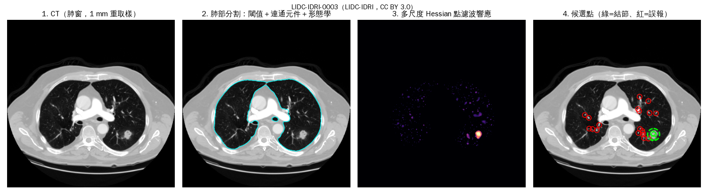
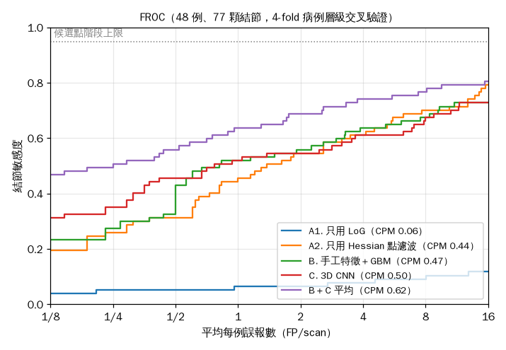

# P1　胸腔 CT 肺結節偵測：傳統影像處理 vs. 深度學習

用公開資料 LIDC-IDRI，把「肺部分割 → 候選點偵測 → 降低誤報」拆成可以逐步檢查的流程，比較純傳統方法、手工特徵＋機器學習、3D CNN 三種做法。全部在 CPU 上完成。

> 研究與學習用途，非醫療器材，不可用於臨床診斷。



## 結果

48 位病人、77 顆目標結節（≥ 3 位醫師標到、直徑 ≥ 3 mm；3～6 mm 28 顆、6～10 mm 21 顆、≥ 10 mm 28 顆），4-fold 病例層級交叉驗證，CPU 完成。

**候選點階段**：每例約 548 個候選，敏感度 **94.8%（73／77）**。依大小：3～6 mm 92.9%、6～10 mm 95.2%、≥ 10 mm 96.4%。

**降低誤報**（CPM 與 95% 信賴區間，信賴區間以病例為單位 bootstrap 1,000 次）：

| 方法 | CPM | 95% CI | 1 FP/scan 敏感度 | 4 FP/scan 敏感度 |
|---|---|---|---|---|
| A1. 只用 LoG 響應排序 | 0.06 | 0.01–0.13 | 0.06 | 0.08 |
| A2. 只用 Hessian 點濾波響應排序 | 0.44 | 0.35–0.54 | 0.45 | 0.61 |
| B. 13 個手工特徵＋Gradient Boosting | 0.47 | 0.35–0.56 | 0.52 | 0.64 |
| C. 3D CNN（約 21 萬參數） | 0.50 | 0.38–0.62 | 0.52 | 0.61 |
| **B＋C 平均** | **0.62** | **0.50–0.72** | **0.64** | **0.74** |

**觀察**

1. **瓶頸先出在候選點階段**。只用 LoG 時，4～6 mm 的小結節常排在第 400～800 名，被每例 300 個的上限切掉；同樣 20 位病人，候選點敏感度從 82%（28／34）提高到 97%（33／34），做法是加入能壓掉血管的 Hessian 點濾波。
2. **LoG 的分數本身幾乎不能用來排序**（CPM 0.06），因為血管分岔處的響應比結節還強；Hessian 點濾波光靠形狀就有 0.44。
3. **手工特徵和 CNN 各自只有 0.47～0.50，平均後到 0.62**。兩者犯的錯不同：手工特徵看形狀與 HU，CNN 看局部紋理與周邊結構。
4. 信賴區間很寬（約 ±0.11），48 例只能看出趨勢。參考：LUNA16 的頂尖方法用 888 例和 GPU 訓練，CPM 在 0.9 以上；這裡的目的是把流程拆開看懂，不是追分數。

**部署**（4 執行緒 CPU）：ONNX 模型 844 KB，與 PyTorch 的輸出差異 < 1e-6；300 個候選 ONNX Runtime 2.3 秒、PyTorch 4.0 秒。完整單例推論約 3.8 分鐘（重取樣與肺分割 50 秒、候選點與特徵 144 秒、分類 32 秒），時間主要花在 3D 濾波，下一步是把濾波搬到 GPU。

**操作點**（`scripts/operating_point.py`）：用各 fold 存下的模型重算測試分數，重算的 CPM 為 0.6234，與交叉驗證結果一致。依「平均每例誤報數」選閾值：

| 每例誤報 | 閾值（B＋C 平均分數） | 敏感度 |
|---|---|---|
| 0.5 | 0.679 | 0.56 |
| **1** | **0.567** | **0.64** |
| 2 | 0.508 | 0.69 |
| 4 | 0.462 | 0.74 |

推論和 P2 服務預設用 1 FP/scan 的閾值 0.567；要更高敏感度（例如當作第二閱片者），可以改用 4 FP/scan 的 0.462。



## 流程

| 步驟 | 方法 | 程式 |
|---|---|---|
| 讀取 | DICOM CT 依 `ImagePositionPatient` 排序、轉 HU；DICOM SEG 依每個 frame 的位置對回切片 | `lungnod/dicom_io.py` |
| 標註整理 | 4 位醫師的標註依 IDC 的分群合併；≥ 3 位醫師且 ≥ 3 mm 為目標，其餘為「不確定」 | `lungnod/annotations.py` |
| 重取樣 | 三線性內插到 1 mm 等向 | `lungnod/preprocess.py` |
| 肺部分割 | HU 閾值、移除碰到邊界的空氣、3D 連通元件、補洞、5 mm 閉運算 | `lungnod/preprocess.py` |
| 候選點 | 多尺度 LoG 與 Hessian 點濾波各取前 300 個區域最大值，合併去重 | `lungnod/candidates.py` |
| 降誤報 | A：只用濾波器分數　B：13 個手工特徵＋Gradient Boosting　C：32³ 區塊的 3D CNN | `scripts/cross_validate.py` |
| 評估 | FROC、CPM（LUNA16），病例層級 4-fold 交叉驗證、bootstrap 95% CI；依每例誤報數選操作點 | `lungnod/froc.py`、`scripts/operating_point.py` |
| 部署 | 匯出 ONNX、與 PyTorch 比對輸出、量測 CPU 延遲；DICOM 資料夾 → JSON | `scripts/export_onnx.py`、`scripts/infer.py` |

每一步的原理、參數取捨和失敗模式：[`docs/影像處理技術筆記.md`](docs/影像處理技術筆記.md)

## 重現

```bash
pip install -r requirements.txt

# 1. 下載資料（約 5 GB，48 位病人；來源為 NCI Imaging Data Commons 的公開 bucket）
python scripts/download_lidc.py --n 48 --out data

# 2. 前處理（每例約 2～4 分鐘，可平行）
python scripts/prepare.py --data data/lidc_idri --out cache --workers 3

# 3. 交叉驗證並訓練最終模型
python scripts/cross_validate.py --cache cache --out results --folds 4 --final

# 4. 選操作點（用各 fold 的模型重算分數）
python scripts/operating_point.py --cache cache --results results

# 5. 匯出 ONNX、單例推論、產生圖表
python scripts/export_onnx.py --weights results/cnn_final.pt --out results/nodule_cnn.onnx
python scripts/infer.py --ct "data/lidc_idri/<病人>/<study>/CT_<series>" --model results/nodule_cnn.onnx \
    --gbm results/gbm_final.joblib --threshold 0.567 --out out
python scripts/make_figures.py --patient data/lidc_idri/LIDC-IDRI-0003 --cache cache --results results --out docs/img

# 單元測試（合成假體，不需要資料）
python -m pytest tests
```

## 限制

- 只有 48 例，信賴區間寬；沒有外部驗證（不同醫院、機型）。
- 只納入切片間距 ≤ 2.5 mm 的序列；更厚的切片小結節會更難偵測。
- 候選點階段只用傳統濾波器，敏感度上限決定了整體上限。
- 3D CNN 很小（約 21 萬參數），沒有做超參數搜尋。

## 資料來源與授權

- LIDC-IDRI：Armato III, S. G., et al. (2011). *Medical Physics*, 38(2), 915–931. 資料以 CC BY 3.0 釋出（TCIA，DOI: 10.7937/K9/TCIA.2015.LO9QL9SX）。
- 標註的 DICOM SEG 轉檔：Fedorov, A., et al. (2018). DICOM re-encoding of volumetrically annotated LIDC-IDRI（DOI: 10.7937/TCIA.2018.h7umfurq），經 NCI Imaging Data Commons 取得。
- 評估規則參考 LUNA16：Setio, A. A. A., et al. (2017). *Medical Image Analysis*, 42, 1–13.
- Hessian 點／線濾波：Li, Q., Sone, S., & Doi, K. (2003). *Medical Physics*, 30(8), 2040–2051.

---

## English summary

**Lung nodule detection on chest CT: classical image processing vs. deep learning (LIDC-IDRI, CPU only).**

The pipeline resamples CT to 1 mm isotropic, segments the lungs with HU thresholding, connected components and morphology, then generates candidates with multi-scale Laplacian-of-Gaussian and a Hessian-based dot filter. Three false-positive reduction methods are compared: filter response only, 13 handcrafted features with gradient boosting, and a small 3D CNN on 32³ patches. Evaluation follows LUNA16 (nodules ≥ 3 mm agreed by ≥ 3 of 4 radiologists; FROC and CPM) with patient-level 4-fold cross-validation and bootstrap confidence intervals.

Results on 48 scans and 77 target nodules: the candidate stage reached 94.8% sensitivity with about 548 candidates per scan. CPM was 0.06 for LoG ranking alone, 0.44 for the Hessian dot filter alone, 0.47 for handcrafted features with gradient boosting, and 0.50 for the 3D CNN. Averaging the last two gave **0.62 (95% CI 0.50–0.72)**, with sensitivity 0.64 at 1 FP/scan and 0.74 at 4 FP/scan. The ONNX model is 844 KB and matches PyTorch within 1e-6; a full CT takes about 3.8 minutes on a 4-thread CPU.

Key lesson: with LoG alone, 4–6 mm nodules often ranked below 400th because vessels dominate the response, so they were cut by the per-scan candidate limit. Adding the Hessian dot filter, which suppresses tubular structures, fixed most of these misses. The bottleneck was the candidate stage, not the classifier.

Research use only; not a medical device.
